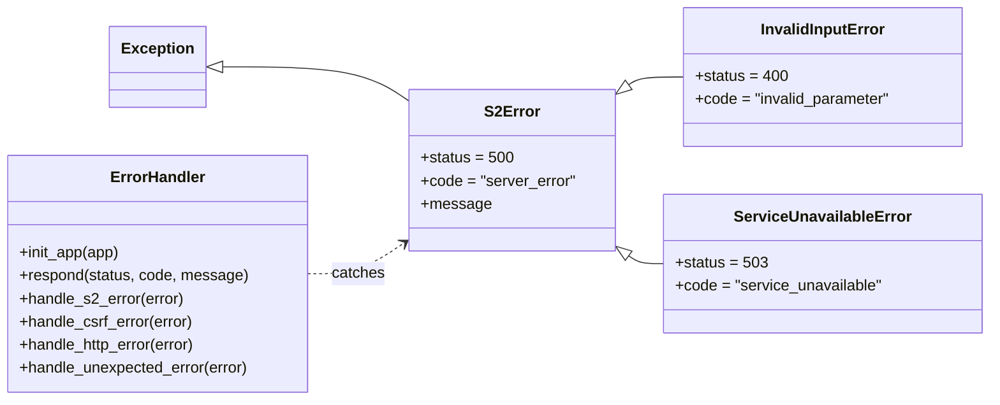

# AI-Powered Smart Energy Management System – Homework Assignment 4

Capstone Team IV, Fachhochschule Dortmund. A web application that monitors the energy use of campus buildings, scores their sustainability and gives advice through an AI coach.

**Homework Assignment 4: error handling and testing.** Each subsystem has its own error-handling class, and the application has 15 automated tests written with Flask's test client.

## Team Overview

| Member | Subsystem | Folder |
| --- | --- | --- |
| Abdelhamid Ahbane | S1 – Monitoring, Simulation & Analytics Engine | `subsystems/s1_analytics` |
| Abdelaziz Jail | S2 – Web Interface & Visualization (Flask) | `subsystems/s2_web` |
| Nestor David Carrizo | S3 – AI Coach, Data Persistence & Deployment | `subsystems/s3_ai_data` |

## System Design

Error-handling classes of each subsystem.

### S2 – Web Interface & Visualization

Every error that S2 raises on purpose inherits from `S2Error`. The `ErrorHandler` class catches these, and any unexpected crash, and answers with a friendly page or a JSON message with the right status code. Users never see a stack trace. Code: `subsystems/s2_web/errors.py`.



| Class | When it is used | Answer |
| --- | --- | --- |
| `InvalidInputError` | Unknown building, bad date, missing parameter, invalid coach question | 400 |
| `ServiceUnavailableError` | S1 (analytics) or S3 (AI coach) does not answer: `PageView.kpis` and `CoachView` turn a `ConnectionError` or `TimeoutError` into this error. On the dashboard a missing coach only hides the tip. | 503 |
| `ErrorHandler` | Registered once in `create_app`; also handles 404, 405, an expired form token and unexpected crashes (500) | Error page, or JSON for `/api/` |

### S1 – Monitoring, Simulation & Analytics Engine

Added by the S1 owner.

### S3 – AI Coach, Data Persistence & Deployment

Added by the S3 owner.

## Tests

The 15 error-handling tests for S2 are in `tests/s2/test_errors.py`. Each test checks one case: the class hierarchy, 400 for bad input and an expired form, 404, 405, 500 without details, and 503 when S1 or S3 is down.

Tested with Python 3.12.

```bash
python3 -m venv .venv
source .venv/bin/activate
pip install -r requirements.txt
pytest tests/s2/test_errors.py -v
```

## Presentation Link

Team video (3 to 5 minutes): _link to be added after recording_.

---

Full S2 documentation (setup, structure, click path, JSON API): [`docs/s2/README.md`](docs/s2/README.md).
