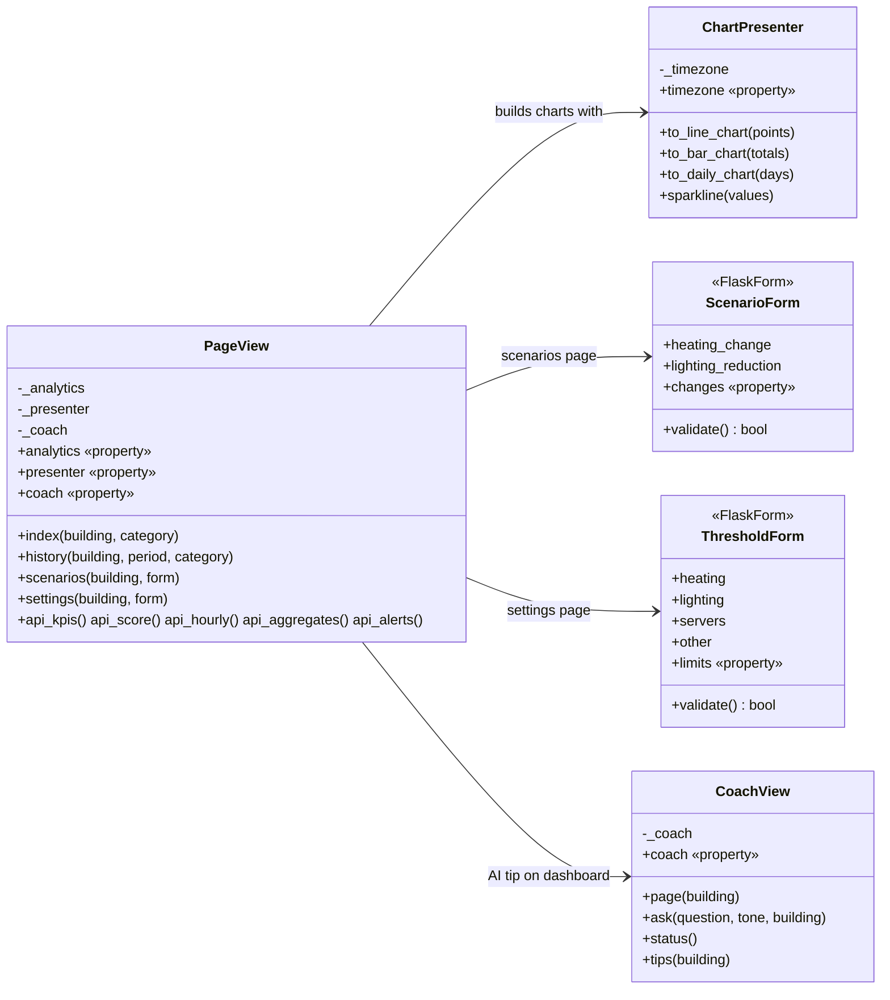
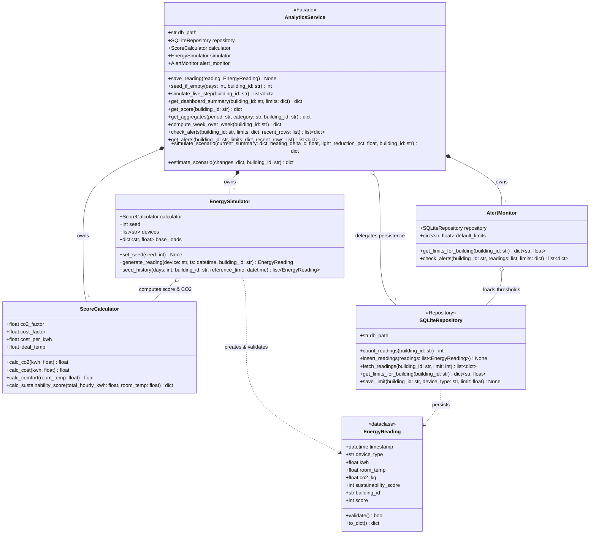

# AI-Powered Smart Energy Management System

Group 7, Fachhochschule Dortmund. A web application that monitors the energy use of campus buildings, scores their sustainability and gives advice through an AI coach. The system has three subsystems, one per team member, each in its own folder under `subsystems/`.

## Team Overview

| Member | Subsystem | Folder / Module |
| --- | --- | --- |
| Abdelhamid Ahbane | S1 – Monitoring, Simulation & Analytics Engine | `subsystems/s1_analytics.py` |
| Abdelaziz Jail | S2 – Web Interface & Visualization (Flask) | `subsystems/s2_web` |
| Nestor David Carrizo | S3 – AI Coach, Data Persistence & Deployment | `subsystems/s3_ai_data` |

## System Design

Class diagrams of the implemented subsystems. Each member adds the diagram of their own subsystem.

### S2 – Web Interface & Visualization

Five classes. `PageView` is the only class the browser reaches; it reads numbers from S1, shapes them with `ChartPresenter`, validates input with the two forms and asks `CoachView` for the AI tip. Every private attribute has a `@property` getter and setter.



| Class | File | Role |
| --- | --- | --- |
| `PageView` | `subsystems/s2_web/views/page_view.py` | Builds the context of every page and the payload of every JSON endpoint. |
| `ChartPresenter` | `subsystems/s2_web/presenter.py` | Turns readings into Chart.js data in the display timezone. |
| `ScenarioForm` | `subsystems/s2_web/forms.py` | What-if inputs: heating change (−3 to +3 °C) and lighting reduction (0 to 50 %). |
| `ThresholdForm` | `subsystems/s2_web/forms.py` | One alert limit per device type (0.1 to 20 kWh/h). |
| `CoachView` | `subsystems/s2_web/views/coach_view.py` | AI Coach page, chat answers and the dashboard tip, on top of the S3 coach. |

### S1 – Monitoring, Simulation & Analytics Engine

Five collaborating UML classes (plus the `SQLiteRepository` offline persistence adapter). `AnalyticsService` is the facade consumed by S2 and S3; it coordinates deterministic device simulation (`EnergySimulator`), pure KPI and sustainability math (`ScoreCalculator`), per-building threshold checks (`AlertMonitor`), and validated measurement records (`EnergyReading`).



| Class | File | Role |
| --- | --- | --- |
| `AnalyticsService` | `subsystems/s1_analytics.py` | Facade coordinating seeding, live steps, KPIs, scores, aggregations, alerts, and what-if scenarios. |
| `EnergySimulator` | `subsystems/s1_analytics.py` | Deterministic generator (`seed=42`) for live device telemetry and 14-day hourly history (`1,344` rows/building). |
| `ScoreCalculator` | `subsystems/s1_analytics.py` | Stateless mathematical engine for CO₂ (`0.38 kg/kWh`), cost (`0.35 €/kWh`), comfort (`21.0 °C`), and score (`0–100`). |
| `AlertMonitor` | `subsystems/s1_analytics.py` | Loads per-building thresholds from storage, merges defaults, and detects device limit breaches. |
| `EnergyReading` | `subsystems/s1_analytics.py` | Dataclass validating non-negative kWh, realistic temperature (`0–45 °C`), device category, and building ID. |


| Exception Class | Inherits From | When Raised |
| --- | --- | --- |
| `AnalyticsError` | `Exception` | Base exception for all Subsystem 1 errors. |
| `InvalidReadingError` | `AnalyticsError`, `ValueError` | Invalid kWh (`< 0`), temperature (`∉ [0, 45] °C`), device type, building ID, or timestamp. |
| `ThresholdConfigurationError` | `AnalyticsError`, `ValueError` | Negative alert limit or blank building ID when saving thresholds. |
| `ScenarioSimulationError` | `AnalyticsError`, `TypeError`, `ValueError` | Unsupported `current_summary` argument type in scenario simulation. |
| `RepositoryError` | `AnalyticsError`, `sqlite3.Error` | SQLite persistence or connection failure in `SQLiteRepository`. |

---

### S3 – AI Coach, Data Persistence & Deployment

Added by the S3 owner.

## Presentation Link

Team video (3 to 5 minutes): _link to be added after recording_.

---

# S1 – Monitoring, Simulation & Analytics Engine

**Owner:** Abdelhamid Ahbane  
**Implementation:** `subsystems/s1_analytics.py` | **Shared Config:** `config.py` | **Test Suite:** `tests/test_s1_analytics.py`  
**Detailed Handoff Docs:** `docs/handoffs_s1/STAGE_1_HANDOFF.md` – `STAGE_5_FINAL_MASTER_HANDOFF.md`

## Core Capabilities & Formulas

* **Supported Buildings:** `library` (default), `lecture-hall-a`, and `lab-building`
* **Device Categories:** `Heating` (`1.4 kWh` base), `Servers` (`1.1 kWh` base), `Lighting` (`0.5 kWh` base), `Other` (`0.3 kWh` base)
* **Mathematical Engine (`ScoreCalculator`):**
  * **CO₂ Emissions:** `round(kWh × 0.38, 2)` kg
  * **Energy Cost:** `round(kWh × 0.35, 2)` EUR
  * **Comfort Index (`K`):** `round(max(0.0, min(1.0, 1.0 - (|room_temp - 21.0| / 10.0))), 2)`
  * **Sustainability Score:** `round(100 × (0.40 × E + 0.35 × C + 0.25 × K))` where `E = 1.0 - (hourly_kwh / 4.0)` and `C = 1.0 - ((hourly_kwh × 0.38) / 1.6)`
* **Deterministic Simulation & Seeding:** Uses an isolated `random.Random(42)` instance with occupancy multipliers (`1.4×` from `08:00–18:00`, `0.6×` off-peak) to seed 14 days of hourly history (`1,344` rows per building) in a single batch transaction (`< 0.05 s`). All returned timestamps are Python `datetime` objects.
* **What-If Scenario Projection (`simulate_scenario` & `estimate_scenario`):** Models heating setpoint changes (`6%` heating delta per `1.0 °C`) and lighting reductions (`0–50%`) without mutating database records.

## S1 Requirements Traceability Matrix

| ID | Requirement Summary | Implemented By | Automated Proof (`tests/test_s1_analytics.py`) |
| :--- | :--- | :--- | :--- |
| **FR1** | Generate realistic device energy readings | `EnergySimulator.generate_reading()`, `simulate_live_step()` | `test_single_calculation_performance_under_50ms`, `test_live_step_and_alert_fallback_safety` |
| **FR2** | Seed 14-day hourly historical dataset (1,344 rows) | `EnergySimulator.seed_history()`, `seed_if_empty()` | `test_seed_and_summary_with_temp_db`, `test_fixed_seed_determinism` |
| **FR3** | Calculate CO₂ emissions and EUR cost | `ScoreCalculator.calc_co2()`, `calc_cost()` | `test_co2_and_cost_calculation` |
| **FR4** | Calculate indoor thermal comfort index | `ScoreCalculator.calc_comfort()` | `test_comfort_score_at_ideal_temp` |
| **FR5** | Calculate weighted sustainability score (0–100) | `ScoreCalculator.calc_sustainability_score()` | `test_comfort_score_at_ideal_temp` |
| **FR6** | Produce unified dashboard KPIs & view model | `AnalyticsService.get_dashboard_summary()`, `get_score()` | `test_seed_and_summary_with_temp_db`, `test_score_alerts_and_scenario_api` |
| **FR7** | Detect threshold alerts & compute aggregations/WoW | `AlertMonitor.check_alerts()`, `get_alerts()`, `get_aggregates()`, `compute_week_over_week()` | `test_week_over_week_and_time_aggregations`, `test_alert_monitor_loads_building_limits`, `test_score_alerts_and_scenario_api` |
| **FR8** | Calculate financial & carbon savings vs. baseline | `AnalyticsService.get_dashboard_summary()` | `test_seed_and_summary_with_temp_db` |
| **FR9** | Project non-destructive What-If scenarios | `AnalyticsService.simulate_scenario()`, `estimate_scenario()` | `test_scenario_reduces_energy_when_heating_lowered`, `test_uml_method_signature_compatibility`, `test_score_alerts_and_scenario_api` |
| **FR10** | Validate and persist readings per building | `EnergyReading.validate()`, `save_reading()` | `test_reading_validation_rejects_negative_kwh`, `test_building_isolation` |
| **NFR1–10** | `< 50 ms` calc, determinism (`seed=42`), modular facade, type safety, safe fallbacks | `s1_analytics.py` & `config.py` | Full 14-test suite in `tests/test_s1_analytics.py`, including `test_returned_timestamps_are_datetime_objects` |

Run the Subsystem 1 test suite:

```bash
python -m pytest tests/test_s1_analytics.py -v
```

---

# S2 – Web interface

Flask frontend (subsystem S2). By default it shows demo data; with `USE_MOCK=false` it reads its data from S1 (analytics) and S3 (AI coach).

## Setup

Tested with Python 3.12.

```bash
python3 -m venv .venv
source .venv/bin/activate
pip install -r requirements.txt
export SECRET_KEY="$(python -c 'import secrets; print(secrets.token_hex(32))')"
```

Development server:

```bash
flask run
```

Production-style server with two workers:

```bash
gunicorn -w 2 -b 127.0.0.1:8000 wsgi:app
```

Tests:

```bash
python -m pytest
```

### Configuration

| Variable | Default | Meaning |
|---|---|---|
| `SECRET_KEY` | none (required) | Signs the session cookie and CSRF tokens. The app refuses to start without it. Use the same value for all workers. |
| `FLASK_DEBUG` | off | Set to `1` only for local debugging. |
| `USE_MOCK` | `true` | `false` reads the data from the real S1 and S3 instead of the demo services. |
| `S1_DB_PATH` | `instance/s1_energy.db` | S1 database; created and filled on first start. S3 also reads it for the coach's building data, so export it when `USE_MOCK=false`. |
| `DATABASE_URL` | `sqlite:///smart_energy.db` | S3 database for the coach's answers and cache; a MySQL address also works. |
| `NVIDIA_API_KEY`, `OPENAI_API_KEY` | none | Optional. With a key the coach answers with a live model; without one it uses its fallback. |
| `MOCK_COACH_STATUS` | `online` | Demo coach status: `online`, `fallback` or `cached`. |

## Structure

```
subsystems/
  s2_web/
    __init__.py        app factory and configuration
    errors.py          S2Error, InvalidInputError, ServiceUnavailableError and the ErrorHandler
    catalog.py         accepted buildings, device types, tones and periods
    forms.py           ScenarioForm and ThresholdForm (Flask-WTF)
    presenter.py       ChartPresenter and the formatting helpers behind it
    services/
      __init__.py      get_analytics(), get_coach() and the view factories: the only way routes reach S1/S3
      analytics.py     MockAnalyticsService (S1 mock)
      coach.py         MockAICoach (S3 mock)
      s1_adapter.py    S1AnalyticsAdapter: the real S1 in the format the pages use
      mock_data.py     report figures and demo fixtures
    views/
      page_view.py     PageView: context for the pages and JSON endpoints
      coach_view.py    CoachView: AI Coach page, chat answers, dashboard tip
      pages.py         the five page routes (parse request, call PageView, render)
      api.py           JSON routes (parse request, call PageView, jsonify)
    templates/         Jinja templates
    static/            style.css, plain JavaScript, Chart.js 4.4.6
tests/s2/              pytest suite for S2
docs/s2/DESIGN.md      visual specification
wsgi.py                entry point for flask run and Gunicorn
```

Pages: Dashboard `/`, History & Alerts `/history`, Scenarios `/scenarios`, AI Coach `/coach`, Settings `/settings`. Every page accepts `?building=`; the choice is kept in the session.

### Click path

Every page is one click away in the navigation rail on the left, and every feature is reached in at most two clicks from the dashboard, within the limit of three (S2-NFR2). Typing in a field is not counted as a click. Start the app, open `http://127.0.0.1:5000/` and follow these steps:

| Feature | Clicks from the dashboard | What you should see |
|---|---|---|
| Today's figures, score gauge and alert banner | 0 | Four KPI cards (15.7 kWh, 6.0 kg CO₂, €5.50, €0.35 saved, €2.35 this week), the score gauge at 82 in the green band, and the banner "Heating is above the limit at 13:00." |
| Explain a metric | 1: the ⓘ next to Sustainability Score, Energy (E), Carbon (C), Comfort (K) or CO₂ today | A tooltip with the formula behind the number |
| Filter by device type | 1: the Heating chip | The cards, trend lines and hourly chart switch to heating only (7.5 kWh) |
| Compare with last week | 1: untick "Compare with last week" | The dashed last-week line disappears from the hourly chart |
| Switch building | 2: building menu at the top, then Lab Building | Every figure changes to the Lab Building demo data |
| Daily use by device type | 2: History & Alerts, then Last 7 days | Stacked bars per day; hovering a bar shows each device type and the day's total |
| Alerts and week-over-week table | 1: History & Alerts | Three alerts (latest first) and last week vs this week (109.9 → 103.3 kWh) |
| What-if scenario | 2: Scenarios, then Calculate scenario after typing −1 and 20 | Before/after: 15.7 → 14.6 kWh, score 82 → 87 |
| Ask the AI coach | 2: AI Coach, then Send after typing a question | The answer as plain text with its source and response time |
| Change alert limits | 2: Settings, then Save limits after setting Lighting to 0.2 | "Limits saved for this session."; back on the dashboard the banner lists the new alerts within 10 s |
| Theme | 1: the theme button in the rail | System → Dark → Light |

## Mock data

`subsystems/s2_web/services/mock_data.py` holds every figure. The Library values (reference date Tuesday 14 May 2024) are the capstone report figures. Lecture Hall A and Lab Building are demonstration datasets made up for the prototype and are labelled as such in the interface. All series are fixed lists or derived from them, so changing building or category never changes history. Only `/api/score` adds a random variation of at most ±0.5 points to the reference score. Times use Europe/Berlin.

## Service integration (provisional contracts)

The interfaces below are provisional contracts for S2's mock services. They describe what S2 needs and do not prescribe how S1 or S3 work internally; when the real subsystems exist, adapters translate their output into this shape.

```python
class MockAnalyticsService:            # S1
    get_kpis(building_id) -> dict
    get_score(building_id) -> dict
    get_hourly(building_id, day, category=None) -> list[tuple[datetime, float]]
    get_aggregates(building_id, period="week", category=None) -> dict[str, float]
    get_week_comparison(building_id) -> dict
    get_alerts(building_id, limit=10) -> list[dict]
    estimate_scenario(building_id, heating_change_c: float, lighting_reduction_pct: int) -> dict
    get_limits(building_id) -> dict[str, float]
    save_limits(building_id, limits: dict[str, float]) -> None

class MockAICoach:                     # S3
    status() -> str                    # "online", "fallback" or "cached"
    ask(question: str, tone: str, building_id: str) -> dict
    tips(building_id) -> list[str]
```

Integration point: `subsystems/s2_web/services/__init__.py`. With `USE_MOCK=false`, `get_analytics()` returns `S1AnalyticsAdapter`, which reads S1's `AnalyticsService` and returns the same format as the mock, and `get_coach()` returns S3's `AICoach` directly, because it already has `ask`, `status` and `tips`. Views and templates did not need to change.

### Session state

Alert limits are saved per building in the signed Flask session cookie. Every Gunicorn worker can read them as long as all workers share `SECRET_KEY`. Limitations: they belong to one browser, disappear when the cookie is cleared or the browser session ends, and are not shared between users. Persistent storage belongs to the integrated system.

## JSON API

All responses are JSON. Times are ISO 8601 with offset (Europe/Berlin), dates are `YYYY-MM-DD`, energy is in kWh, CO₂ in kg and cost in EUR. Every response that concerns a building includes `building: {"id", "name", "data"}`, where `data` is `reference` (report figures) or `demo`. A value of `null` in a chart series means no reading for that interval.

Accepted values: `building` = `library`, `lecture-hall-a`, `lab-building`; `category` = `heating`, `lighting`, `servers`, `other` (omit for all); `period` = `today`, `week`, `7d`, `30d` (`week` and `7d` both mean the 7 days ending on the report date); `tone` = `encouraging`, `analytical`, `strict`.

Errors use HTTP 400 (404 for unknown routes, 405 for a wrong method, 503 when S1 or S3 does not answer) and this shape:

```json
{"error": {"code": "invalid_parameter", "message": "'building' must be one of: library, lecture-hall-a, lab-building."}}
```

Error codes: `missing_parameter`, `invalid_parameter`, `invalid_request`, `csrf_failed`, `not_found`, `method_not_allowed`, `service_unavailable`, `server_error`.

Charts share one structure, built in `presenter.py` and drawn by `static/js/common.js`:

```json
{"type": "line", "labels": ["00:00", "01:00"], "datasets": [{"key": "primary", "label": "Today", "data": [0.06, 0.06]}],
 "unit": "kWh", "x_title": "Hour", "y_title": "kWh", "limit": {"value": 2.0, "label": "Limit: 2.0 kWh"},
 "above_limit": [13], "summary": "Total 7.5 kWh. Peak 2.40 kWh at 13:00. Above the 2.0 kWh limit at 13:00."}
```

### GET /api/kpis

Parameters: `building` (required), `category` (optional). Savings stay building-wide (`scope: "building"`) because the data has no per-category savings.

```json
{"building": {"id": "library", "name": "Library", "data": "reference"}, "date": "2024-05-14", "category": "heating",
 "kpis": {
   "energy": {"value": 7.5, "unit": "kWh", "display": "7.5", "change_pct": -6, "change_display": "6%", "trend": "down", "compared_to": "vs last week"},
   "co2": {"value": 2.9, "unit": "kg", "display": "2.9", "change_pct": -6, "change_display": "6%", "trend": "down", "compared_to": "vs last week", "help": "Energy use × 0.38 kg CO₂ per kWh, …"},
   "cost": {"value": 2.62, "unit": "EUR", "display": "€2.62", "change_pct": -6, "change_display": "6%", "trend": "down", "compared_to": "vs last week"},
   "savings": {"value": 0.35, "unit": "EUR", "display": "€0.35", "co2_kg": 1.0, "co2_display": "1.0", "change_pct": -6, "change_display": "6%", "trend": "down", "compared_to": "vs normal use", "negative": false, "scope": "building",
               "week": {"eur": 2.35, "co2_kg": 2.5, "display": "€2.35", "co2_display": "2.5", "negative": false}}}}
```

`savings.week` is this week against last week, from the week comparison. `negative` is `true` when more was used than the baseline; the page then shows the value in red. Every card also carries a `spark` trend line (left out above).

Error (`GET /api/kpis`): `{"error": {"code": "missing_parameter", "message": "'building' is required."}}`

### GET /api/score

Parameters: `building` (required). Simulated live reading with one decimal; `reference_score` is the whole-number report value. `band` is the gauge colour (`red` below 60, `amber` 60–80, `green` above 80) and `needle_deg` the needle angle from −90 (0) to 90 (100). `help` holds the tooltip text.

```json
{"building": {"id": "library", "name": "Library", "data": "reference"}, "label": "Building score", "scope": "building",
 "score": 82.1, "display": "82.1", "reference_score": 82, "target": 90,
 "band": {"band": "green", "label": "Good", "needle_deg": 57.8}, "reference_band": {"band": "green", "label": "Good", "needle_deg": 57.6},
 "help": "Weighted mix of energy, carbon and comfort, from 0 to 100. Red below 60, amber 60 to 80, green above 80.",
 "components": {"energy": {"value": 0.86, "display": "0.86", "weight": 0.4, "help": "E, weight 0.40: …"}, "carbon": {"value": 0.81, "display": "0.81", "weight": 0.35, "help": "C, weight 0.35: …"}, "comfort": {"value": 0.78, "display": "0.78", "weight": 0.25, "help": "K, weight 0.25: …"}},
 "formula": "Score = 100 × (0.40·E + 0.35·C + 0.25·K)", "measured_at": "2026-10-21T00:12:18+02:00", "time_display": "00:12:18"}
```

Error (`?building=mensa`): `{"error": {"code": "invalid_parameter", "message": "'building' must be one of: library, lecture-hall-a, lab-building."}}`

### GET /api/hourly

Parameters: `building` (required), `day` (default: report date, fixtures cover 2024-04-15 to 2024-05-14), `category` (optional), `compare=0|1` (default `0`). `limit_kwh` is set only for a single category. The comparison series is the same weekday one week earlier and is omitted (`comparison_day: null`) when that day has no fixture.

```json
{"building": {"id": "library", "name": "Library", "data": "reference"}, "day": "2024-05-14", "category": "heating",
 "unit": "kWh", "interval": "1h", "timestamps": ["2024-05-14T00:00:00+02:00", "…"], "comparison_day": "2024-05-07", "limit_kwh": 2.0,
 "chart": {"type": "line", "labels": ["00:00", "…"], "datasets": [{"key": "primary", "label": "Today", "data": [0.06, "…"]}, {"key": "comparison", "label": "Last week", "data": [0.09, "…"]}],
           "unit": "kWh", "x_title": "Hour", "y_title": "kWh", "limit": {"value": 2.0, "label": "Limit: 2.0 kWh"}, "above_limit": [13],
           "summary": "Total 7.5 kWh. Peak 2.40 kWh at 13:00. Above the 2.0 kWh limit at 13:00."}}
```

Error (`?building=library&day=14.05.2024`): `{"error": {"code": "invalid_parameter", "message": "'day' must be a date in YYYY-MM-DD format."}}`

### GET /api/aggregates

Parameters: `building` (required), `period` (default `week`). `daily_chart` is `null` for `today`; otherwise it is a stacked bar chart with one dataset per device type and the day `totals`.

```json
{"building": {"id": "library", "name": "Library", "data": "reference"}, "period": "week", "start": "2024-05-08", "end": "2024-05-14",
 "unit": "kWh", "total_kwh": 103.3,
 "categories": [{"id": "heating", "label": "Heating", "kwh": 49.6, "share_pct": 48}, {"id": "lighting", "label": "Lighting", "kwh": 20.7, "share_pct": 20},
                {"id": "servers", "label": "Servers", "kwh": 22.7, "share_pct": 22}, {"id": "other", "label": "Other", "kwh": 10.3, "share_pct": 10}],
 "chart": {"type": "bar", "labels": ["Heating", "Lighting", "Servers", "Other"], "categories": ["heating", "lighting", "servers", "other"],
           "datasets": [{"key": "share", "label": "Share of total", "data": [48, 20, 22, 10]}], "unit": "%", "…": "…"},
 "daily_chart": {"type": "bar", "stacked": true, "labels": ["Wed 8 May", "…"], "categories": ["heating", "lighting", "servers", "other"],
                 "datasets": [{"key": "heating", "label": "Heating", "data": [7.63, "…"]}, "…"], "totals": [15.9, "…"], "unit": "kWh", "…": "…"}}
```

Error (`?building=library&period=year`): `{"error": {"code": "invalid_parameter", "message": "'period' must be one of: today, week, 7d, 30d."}}`

### GET /api/alerts

Parameters: `building` (required). Readings above the session's limits, latest first, at most 10. `banner` lists today's alerts for the dashboard (`null` when there are none); the dashboard requests it every 10 s and uses `key` to tell a new alert from one already dismissed.

```json
{"building": {"id": "library", "name": "Library", "data": "reference"}, "unit": "kWh",
 "limits_kwh": {"heating": 2.0, "lighting": 0.8, "servers": 3.5, "other": 1.0},
 "alerts": [{"time": "2024-05-14T13:00:00+02:00", "time_label": "Today 13:00", "category": "heating", "category_label": "Heating",
             "value_kwh": 2.4, "limit_kwh": 2.0, "value_display": "2.4 kWh", "limit_display": "2.0 kWh", "message": "Heating above limit: 2.4 kWh"}],
 "banner": {"key": "2024-05-14T13:00:00+02:00/heating", "title": "Heating is above the limit at 13:00.",
            "text": "The heating load (2.4 kWh) exceeds the defined limit of 2.0 kWh.", "lines": []}}
```

Error (`GET /api/alerts`): `{"error": {"code": "missing_parameter", "message": "'building' is required."}}`

### POST /api/coach/ask

Requires the CSRF token in the `X-CSRFToken` header (the pages provide it in `<meta name="csrf-token">`). Body: `{"question": "...", "tone": "encouraging", "building": "library"}`. `question` is trimmed and must be 1–500 characters; `building` defaults to `library`, but the frontend always sends it. `response_time_s` is `null` for fallback and cached answers.

```json
{"building": "library", "question": "How can we reduce energy use in the afternoon?", "tone": "encouraging",
 "answer": "Lower the heating by 1 °C between 13:00 and 17:00. This saves about 1.1 kWh per day (−7%) and keeps the rooms comfortable.",
 "source": "OpenAI", "response_time_s": 2.1, "answered_at": "2026-10-21T00:12:18+02:00"}
```

Errors: `{"error": {"code": "invalid_parameter", "message": "'question' must be a non-empty text."}}`, or `csrf_failed` when the token is missing.

### GET /api/coach/status

```json
{"status": "online", "label": "Online", "checked_at": "2026-10-21T00:12:18+02:00"}
```

Error (`POST /api/coach/status`, HTTP 405): `{"error": {"code": "method_not_allowed", "message": "This address does not support that kind of request."}}`
