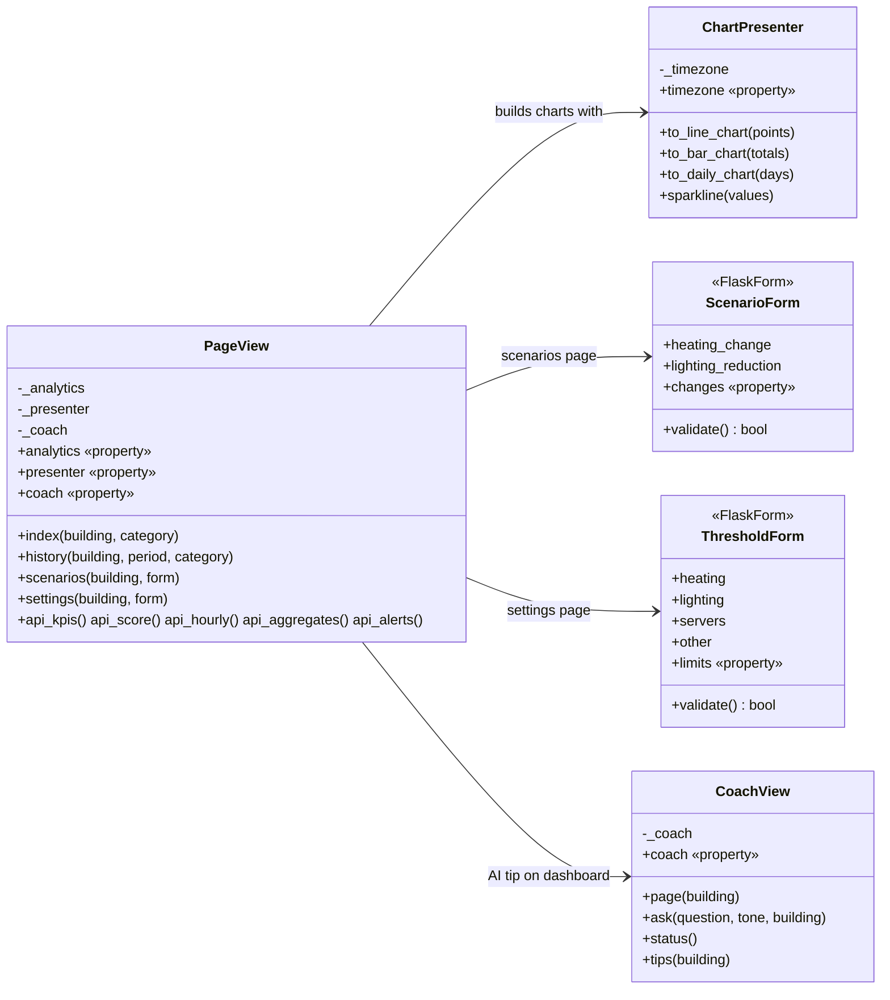

# AI-Powered Smart Energy Management System

Group 7, Fachhochschule Dortmund. A web application that monitors the energy use of campus buildings, scores their sustainability and gives advice through an AI coach. The system has three subsystems, one per team member, each in its own folder under `subsystems/`.

## Team Overview

| Member | Subsystem | Folder |
| --- | --- | --- |
| Abdelhamid Ahbane | S1 – Monitoring, Simulation & Analytics Engine | `subsystems/s1_analytics` |
| Abdelaziz Jail | S2 – Web Interface & Visualization (Flask) | `subsystems/s2_web` |
| Nestor David Carrizo | S3 – AI Coach, Data Persistence & Deployment | `subsystems/s3_coach` |

## System Design

Class diagrams of the implemented subsystems. Each member adds the diagram of their own subsystem.

### S2 – Web Interface & Visualization

Five classes. `PageView` is the only class the browser reaches; it reads numbers from S1, shapes them with `ChartPresenter`, validates input with the two forms and asks `CoachView` for the AI tip. Every private attribute has a `@property` getter and setter.



| Class | File | Role |
| --- | --- | --- |
| `PageView` | `subsystems/s2_web/views/page_view.py` | Builds the context of every page and the payload of every JSON endpoint. |
| `ChartPresenter` | `subsystems/s2_web/presenter.py` | Turns readings into Chart.js data in the display timezone. |
| `ScenarioForm` | `subsystems/s2_web/forms.py` | What-if inputs: heating change (−3 to +3 °C) and lighting reduction (0 to 50 %). |
| `ThresholdForm` | `subsystems/s2_web/forms.py` | One alert limit per device type (0.1 to 20 kWh/h). |
| `CoachView` | `subsystems/s2_web/views/coach_view.py` | AI Coach page, chat answers and the dashboard tip, on top of the S3 coach. |

### S1 – Monitoring, Simulation & Analytics Engine

Added by the S1 owner.

### S3 – AI Coach, Data Persistence & Deployment

Six main classes. `AICoach` is the central orchestrator that S1 and S2 interact with; it manages caching via `MySQLRepository` and delegates generation to a strategy interface (`LLMClient`) implemented by `OpenAIClient`, `NVIDIAClient`, and `FallbackCoach`. Domain errors are handled through the `S3CoachError` exception hierarchy. Every private attribute uses `@property` getters and setters for state initialization and encapsulation.


| Class | File | Role |
| --- | --- | --- |
| `AICoach` | `subsystems/s3_coach/s3_ai_coach.py` | Orchestrator that checks cache, attempts live APIs, and handles fallbacks. |
| `MySQLRepository` | `subsystems/s3_coach/s3_repository.py` | Handles database persistence and retrieves cached AI recommendations. |
| `LLMClient` | `subsystems/s3_coach/s3_ai_coach.py` | Abstract interface defining the contract for all AI recommendation engines. |
| `OpenAIClient` & `NVIDIAClient` | `subsystems/s3_coach/s3_ai_coach.py` | Live API strategies with secure environment key encapsulation. |
| `FallbackCoach` | `subsystems/s3_coach/s3_ai_coach.py` | Rule-based local engine for offline or API-error scenarios. |
| `S3CoachError` | `subsystems/s3_coach/s3_errors.py` | Custom exception hierarchy (`S3ConfigurationError`, `S3APIError`, `S3DatabaseError`). |
| `AIRecommendation` | `subsystems/s3_coach/s3_models.py` | SQLAlchemy ORM model for the `ai_recommendations` caching table. |

## Presentation Link

Team video (3 to 5 minutes): _link to be added after recording_.

---

# S2 – Web interface

Flask frontend (subsystem S2). All data comes from mock services; the analytics (S1) and AI coach (S3) subsystems are not connected yet.

## Setup

Tested with Python 3.12.

```bash
python3 -m venv .venv
source .venv/bin/activate
pip install -r requirements.txt
export SECRET_KEY="$(python -c 'import secrets; print(secrets.token_hex(32))')"
```

Development server:

```bash
flask run
```

Production-style server with two workers:

```bash
gunicorn -w 2 -b 127.0.0.1:8000 wsgi:app
```

Tests:

```bash
pytest
```

### Configuration

| Variable | Default | Meaning |
|---|---|---|
| `SECRET_KEY` | none (required) | Signs the session cookie and CSRF tokens. The app refuses to start without it. Use the same value for all workers. |
| `FLASK_DEBUG` | off | Set to `1` only for local debugging. |
| `USE_MOCK` | `true` | `false` stops the app with a configuration error until real S1/S3 adapters exist. |
| `MOCK_COACH_STATUS` | `online` | Mock coach status: `online`, `fallback` or `cached`. |

## Structure

```
subsystems/
  s2_web/
    __init__.py        app factory, configuration, error handlers
    catalog.py         accepted buildings, device types, tones and periods
    forms.py           ScenarioForm and ThresholdForm (Flask-WTF)
    presenter.py       ChartPresenter and the formatting helpers behind it
    services/
      __init__.py      get_analytics(), get_coach() and the view factories: the only way routes reach S1/S3
      analytics.py     MockAnalyticsService (S1 mock)
      coach.py         MockAICoach (S3 mock)
      mock_data.py     report figures and demo fixtures
    views/
      page_view.py     PageView: context for the pages and JSON endpoints
      coach_view.py    CoachView: AI Coach page, chat answers, dashboard tip
      pages.py         the five page routes (parse request, call PageView, render)
      api.py           JSON routes (parse request, call PageView, jsonify)
    templates/         Jinja templates
    static/            style.css, plain JavaScript, Chart.js 4.4.6
tests/s2/              pytest suite for S2
docs/s2/DESIGN.md      visual specification
wsgi.py                entry point for flask run and Gunicorn
```

Pages: Dashboard `/`, History & Alerts `/history`, Scenarios `/scenarios`, AI Coach `/coach`, Settings `/settings`. Every page accepts `?building=`; the choice is kept in the session.

## Mock data

`subsystems/s2_web/services/mock_data.py` holds every figure. The Library values (reference date Tuesday 14 May 2024) are the capstone report figures. Lecture Hall A and Lab Building are demonstration datasets made up for the prototype and are labelled as such in the interface. All series are fixed lists or derived from them, so changing building or category never changes history. Only `/api/score` adds a random variation of at most ±0.5 points to the reference score. Times use Europe/Berlin.

## Service integration (provisional contracts)

The interfaces below are provisional contracts for S2's mock services. They describe what S2 needs and do not prescribe how S1 or S3 work internally; when the real subsystems exist, adapters translate their output into this shape.

```python
class MockAnalyticsService:            # S1
    get_kpis(building_id) -> dict
    get_score(building_id) -> dict
    get_hourly(building_id, day, category=None) -> list[tuple[datetime, float]]
    get_aggregates(building_id, period="week", category=None) -> dict[str, float]
    get_week_comparison(building_id) -> dict
    get_alerts(building_id, limit=10) -> list[dict]
    estimate_scenario(building_id, heating_change_c: float, lighting_reduction_pct: int) -> dict
    get_limits(building_id) -> dict[str, float]
    save_limits(building_id, limits: dict[str, float]) -> None

class MockAICoach:                     # S3
    status() -> str                    # "online", "fallback" or "cached"
    ask(question: str, tone: str, building_id: str) -> dict
    tips(building_id) -> list[str]
```

Integration point: `subsystems/s2_web/services/__init__.py`. Replace the two factory functions with adapters for the real services and remove the `USE_MOCK` check in `subsystems/s2_web/__init__.py`. Views and templates do not need to change.

### Session state

Alert limits are saved per building in the signed Flask session cookie. Every Gunicorn worker can read them as long as all workers share `SECRET_KEY`. Limitations: they belong to one browser, disappear when the cookie is cleared or the browser session ends, and are not shared between users. Persistent storage belongs to the integrated system.

## JSON API

All responses are JSON. Times are ISO 8601 with offset (Europe/Berlin), dates are `YYYY-MM-DD`, energy is in kWh, CO₂ in kg and cost in EUR. Every response that concerns a building includes `building: {"id", "name", "data"}`, where `data` is `reference` (report figures) or `demo`. A value of `null` in a chart series means no reading for that interval.

Accepted values: `building` = `library`, `lecture-hall-a`, `lab-building`; `category` = `heating`, `lighting`, `servers`, `other` (omit for all); `period` = `today`, `week`, `7d`, `30d` (`week` and `7d` both mean the 7 days ending on the report date); `tone` = `encouraging`, `analytical`, `strict`.

Errors use HTTP 400 (404 for unknown routes, 405 for a wrong method) and this shape:

```json
{"error": {"code": "invalid_parameter", "message": "'building' must be one of: library, lecture-hall-a, lab-building."}}
```

Error codes: `missing_parameter`, `invalid_parameter`, `invalid_request`, `csrf_failed`, `not_found`, `method_not_allowed`, `server_error`.

Charts share one structure, built in `presenter.py` and drawn by `static/js/common.js`:

```json
{"type": "line", "labels": ["00:00", "01:00"], "datasets": [{"key": "primary", "label": "Today", "data": [0.06, 0.06]}],
 "unit": "kWh", "x_title": "Hour", "y_title": "kWh", "limit": {"value": 2.0, "label": "Limit: 2.0 kWh"},
 "above_limit": [13], "summary": "Total 7.5 kWh. Peak 2.40 kWh at 13:00. Above the 2.0 kWh limit at 13:00."}
```

### GET /api/kpis

Parameters: `building` (required), `category` (optional). Savings stay building-wide (`scope: "building"`) because the data has no per-category savings.

```json
{"building": {"id": "library", "name": "Library", "data": "reference"}, "date": "2024-05-14", "category": "heating",
 "kpis": {
   "energy": {"value": 7.5, "unit": "kWh", "display": "7.5", "change_pct": -6, "change_display": "6%", "trend": "down", "compared_to": "vs last week"},
   "co2": {"value": 2.9, "unit": "kg", "display": "2.9", "change_pct": -6, "change_display": "6%", "trend": "down", "compared_to": "vs last week"},
   "cost": {"value": 2.62, "unit": "EUR", "display": "€2.62", "change_pct": -6, "change_display": "6%", "trend": "down", "compared_to": "vs last week"},
   "savings": {"value": 0.35, "unit": "EUR", "display": "€0.35", "co2_kg": 1.0, "co2_display": "1.0", "change_pct": -6, "change_display": "6%", "trend": "down", "compared_to": "vs normal use", "scope": "building"}}}
```

Error (`GET /api/kpis`): `{"error": {"code": "missing_parameter", "message": "'building' is required."}}`

### GET /api/score

Parameters: `building` (required). Simulated live reading with one decimal; `reference_score` is the whole-number report value.

```json
{"building": {"id": "library", "name": "Library", "data": "reference"}, "label": "Building score", "scope": "building",
 "score": 82.1, "display": "82.1", "reference_score": 82, "target": 90,
 "components": {"energy": {"value": 0.86, "display": "0.86", "weight": 0.4}, "carbon": {"value": 0.81, "display": "0.81", "weight": 0.35}, "comfort": {"value": 0.78, "display": "0.78", "weight": 0.25}},
 "formula": "Score = 100 × (0.40·E + 0.35·C + 0.25·K)", "measured_at": "2026-10-21T00:12:18+02:00", "time_display": "00:12:18"}
```

Error (`?building=mensa`): `{"error": {"code": "invalid_parameter", "message": "'building' must be one of: library, lecture-hall-a, lab-building."}}`

### GET /api/hourly

Parameters: `building` (required), `day` (default: report date, fixtures cover 2024-04-15 to 2024-05-14), `category` (optional), `compare=0|1` (default `0`). `limit_kwh` is set only for a single category. The comparison series is the same weekday one week earlier and is omitted (`comparison_day: null`) when that day has no fixture.

```json
{"building": {"id": "library", "name": "Library", "data": "reference"}, "day": "2024-05-14", "category": "heating",
 "unit": "kWh", "interval": "1h", "timestamps": ["2024-05-14T00:00:00+02:00", "…"], "comparison_day": "2024-05-07", "limit_kwh": 2.0,
 "chart": {"type": "line", "labels": ["00:00", "…"], "datasets": [{"key": "primary", "label": "Today", "data": [0.06, "…"]}, {"key": "comparison", "label": "Last week", "data": [0.09, "…"]}],
           "unit": "kWh", "x_title": "Hour", "y_title": "kWh", "limit": {"value": 2.0, "label": "Limit: 2.0 kWh"}, "above_limit": [13],
           "summary": "Total 7.5 kWh. Peak 2.40 kWh at 13:00. Above the 2.0 kWh limit at 13:00."}}
```

Error (`?building=library&day=14.05.2024`): `{"error": {"code": "invalid_parameter", "message": "'day' must be a date in YYYY-MM-DD format."}}`

### GET /api/aggregates

Parameters: `building` (required), `period` (default `week`). `daily_chart` is `null` for `today`.

```json
{"building": {"id": "library", "name": "Library", "data": "reference"}, "period": "week", "start": "2024-05-08", "end": "2024-05-14",
 "unit": "kWh", "total_kwh": 103.3,
 "categories": [{"id": "heating", "label": "Heating", "kwh": 49.6, "share_pct": 48}, {"id": "lighting", "label": "Lighting", "kwh": 20.7, "share_pct": 20},
                {"id": "servers", "label": "Servers", "kwh": 22.7, "share_pct": 22}, {"id": "other", "label": "Other", "kwh": 10.3, "share_pct": 10}],
 "chart": {"type": "bar", "labels": ["Heating", "Lighting", "Servers", "Other"], "categories": ["heating", "lighting", "servers", "other"],
           "datasets": [{"key": "share", "label": "Share of total", "data": [48, 20, 22, 10]}], "unit": "%", "…": "…"},
 "daily_chart": {"type": "bar", "labels": ["Wed 8 May", "…"], "datasets": [{"key": "primary", "label": "Energy use", "data": [15.9, "…"]}], "unit": "kWh", "…": "…"}}
```

Error (`?building=library&period=year`): `{"error": {"code": "invalid_parameter", "message": "'period' must be one of: today, week, 7d, 30d."}}`

### GET /api/alerts

Parameters: `building` (required). Readings above the session's limits, latest first, at most 10.

```json
{"building": {"id": "library", "name": "Library", "data": "reference"}, "unit": "kWh",
 "limits_kwh": {"heating": 2.0, "lighting": 0.8, "servers": 3.5, "other": 1.0},
 "alerts": [{"time": "2024-05-14T13:00:00+02:00", "time_label": "Today 13:00", "category": "heating", "category_label": "Heating",
             "value_kwh": 2.4, "limit_kwh": 2.0, "value_display": "2.4 kWh", "limit_display": "2.0 kWh", "message": "Heating above limit: 2.4 kWh"}]}
```

Error (`GET /api/alerts`): `{"error": {"code": "missing_parameter", "message": "'building' is required."}}`

### POST /api/coach/ask

Requires the CSRF token in the `X-CSRFToken` header (the pages provide it in `<meta name="csrf-token">`). Body: `{"question": "...", "tone": "encouraging", "building": "library"}`. `question` is trimmed and must be 1–500 characters; `building` defaults to `library`, but the frontend always sends it. `response_time_s` is `null` for fallback and cached answers.

```json
{"building": "library", "question": "How can we reduce energy use in the afternoon?", "tone": "encouraging",
 "answer": "Lower the heating by 1 °C between 13:00 and 17:00. This saves about 1.1 kWh per day (−7%) and keeps the rooms comfortable.",
 "source": "OpenAI", "response_time_s": 2.1, "answered_at": "2026-10-21T00:12:18+02:00"}
```

Errors: `{"error": {"code": "invalid_parameter", "message": "'question' must be a non-empty text."}}`, or `csrf_failed` when the token is missing.

### GET /api/coach/status

```json
{"status": "online", "label": "Online", "checked_at": "2026-10-21T00:12:18+02:00"}
```

Error (`POST /api/coach/status`, HTTP 405): `{"error": {"code": "method_not_allowed", "message": "This address does not support that kind of request."}}`

---

# S3 – AI Coach, Data Persistence & Deployment

Backend subsystem managing the AI recommendation engine and the primary MySQL database layer. It implements a Strategy pattern to switch between live LLMs and a local rule-based fallback, and uses SQLAlchemy for robust ORM encapsulation.

## Setup

Tested with Python 3.12.

```bash
python3 -m venv .venv
source .venv/bin/activate
pip install -r requirements.txt
```

Set up API keys for the AI engines

```bash
export OPENAI_API_KEY="openai-key-here"
export NVIDIA_API_KEY="nvidia-key-here"
```

Tests (using in-memory SQLite for isolated repository testing)

```bash
pytest tests/s3/
```

### Configuration

| Variable | Default | Meaning |
|---|---|---|
| `OPENAI_API_KEY` | none | Required for `OpenAIClient`. If missing, the orchestrator falls back to other strategies. |
| `NVIDIA_API_KEY` | none | Required for `NVIDIAClient`. If missing, the orchestrator skips to OpenAI or Fallback. |
| `DATABASE_URI` | `sqlite:///:memory:` | SQLAlchemy connection string. In production, this points to the S3 MySQL container. |


## Structure

```
subsystems/
  s3_coach/
    __init__.py          module initialization
    s3_models.py         SQLAlchemy declarative base, Enums, and ORM models (7 tables)
    s3_repository.py     MySQLRepository: encapsulated database session management
    s3_ai_coach.py       AICoach orchestrator and Strategy implementations (LLMClient)
    s3_errors.py         Custom OOP exception hierarchy (S3CoachError, S3ConfigurationError, etc.)
tests/s3/                Unified test suite covering models, repository, coach, and error handling
```

## Database Schema (SQLAlchemy ORM)

S3 owns the relational schema. While tests run on an in-memory SQLite database, production uses MySQL 8 with InnoDB transactions. The schema enforces integrity with foreign keys and strict types.

Tables managed: `buildings`, `devices`, `energy_logs`, `alerts`, `sustainability_snapshots`, `settings`, and `ai_recommendations` (used as the caching layer for AI responses to save tokens and reduce latency).

## Service Integration (Internal Python API)

S2 and S1 interact with S3 exclusively through the instantiated `AICoach` and `MySQLRepository` objects. The orchestrator automatically handles cache lookups, API failures, and fallbacks, raising custom `S3CoachError` exceptions if invalid states are injected.

```python
class AICoach:
    # Setup
    repo: MySQLRepository                  # Protected via @property
    last_source: str                       # Protected via @property ("Online", "Fallback", "Cached")
    
    # Core Methods
    ask(question: str, tone: str, building_id: str) -> dict
    # Returns: {"answer": "...", "source": "openai|nvidia|fallback|cache"}
    
    status() -> str
    # Returns: "Online", "Fallback", or "Cached" based on the last interaction
    
    get_recommendation(building_id: str, anomaly_data: dict, tone: str="analytical") -> str
    # Returns: the recommendation string (JSON format).

    tips(building_id: str) -> list
    # Returns: A list of actionable daily energy tips for the S2 Dashboard.

class MySQLRepository:
    session: Session                       # SQLAlchemy session, protected via @property
    
    # AI Caching
    get_cached_recommendation(building_id: str, context_hash: str) -> Optional[str]
    save_ai_recommendation(building_id, context_hash, tone, response, source, tokens)
    
    # S1 & S2 Data Contracts
    get_limits(building_id: str) -> dict
    save_limits(building_id: str, limits: dict) -> None
    save_energy_log(building_id: str, device_id: int, timestamp: datetime, consumption: float, co2: float, temp: float, comfort: float) -> None
    save_alert(building_id: str, timestamp: datetime, alert_type: str, message: str, threshold: float, value: float) -> None
```

## AI Caching Strategy

To prevent redundant API calls, every request to the `AICoach` generates a SHA-256 hash combining the input data/question and the selected tone. If a match is found in the `ai_recommendations` table, the cached response is returned in milliseconds with `source: "cache"`.